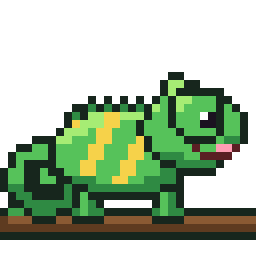

# ovg



**Odin vector graphics.** A 2D vector canvas for Odin that started as a port of
[femtovg](https://github.com/femtovg/femtovg) (the nanovg lineage) and grew well
beyond it.

From femtovg: the canvas API (paths, strokes, gradients, image paints,
scissoring, compositing, render-to-image), recording commands for a
backend. Fills and strokes no longer tessellate: every path is drawn by
exact per-pixel coverage of its curves (see Shapes below).

Added in ovg:

- **Dashes**: dash arrays, offsets and `pathLength`.
- **Path morphs**: `path_morph_prepare` / `path_morph_eval` blend any two
  paths (contours paired, resampled by arc length, holes kept; unpaired
  contours grow from or shrink to a point), with text (`text_layout_path`)
  and SVG geometry (`svg_element_path`) as paths to morph.
- **Path booleans**: union, difference, intersection, xor and simplify of
  filled paths, keeping their curves (see Path booleans below).
- **Layers**: group opacity, clip paths, alpha and luminance masks, 16 blend
  modes and patterns, each sized to its content.
- **SVG filters**: every SVG 1.1 primitive (blur, drop shadow, offset, flood,
  composite, merge, blend, colour matrix, component transfer, morphology,
  turbulence, diffuse / specular lighting, tile, displacement map, convolve
  matrix, image), with filter regions, subregions and linearRGB.
- **SVG import**: `svg_parse` / `svg_draw` with CSS styling, `<use>`, gradients,
  patterns, masks, filters and text, plus per-element overrides for animation
  (88.5% of the resvg test suite).
- **Lottie import**: `lottie_parse` / `lottie_draw` for After Effects
  (Bodymovin) animations: precomps, mattes, masks, trim paths, eased
  keyframes, layer effects (blur, drop shadow, fill, tint, tritone) and
  text layers with text animators.
- **Text**: OpenType shaping with [oglyph](https://github.com/defnotmid/oglyph)
  (Odin, MIT, written alongside ovg and checked against HarfBuzz) (ligatures, kerning, mark positioning, Arabic, Indic and
  the other complex scripts, bidi), per-glyph font fallback, multi-style layout and baselines,
  drawn as vector outlines; colour emoji from COLR v0 / v1 fonts, also
  vectors (Noto Color Emoji bundled as an optional fallback).
- **Custom shader programs**: register compiled shaders (oksl's SkSL or Shadertoy GLSL) and run them
  as layers, with image, video or group children.
- **Recording and playback**: record a frame's commands on one thread and play
  them on the GPU thread, for parallel frame building.

Two backends: a software rasterizer and an SDL_GPU backend (SDL3's GPU API:
Vulkan on Linux, Metal on macOS, Vulkan or D3D12 on Windows). Fonts are
read and text shaped by [oglyph](https://github.com/defnotmid/oglyph), images
decoded and PNGs written by [odecs](https://github.com/defnotmid/odecs) (both
Odin, MIT), read through the `deps` collection: clone them next to ovg and
build with `-collection:deps=..` (the directory holding all three). The other
dependencies are Odin's own `vendor` packages:

| package | needs |
| --- | --- |
| `ovg` (core + software backend) | `deps:oglyph/font`, `deps:oglyph/shape` ([oglyph](https://github.com/defnotmid/oglyph) v0.0.6), `deps:odecs/image` ([odecs](https://github.com/defnotmid/odecs) v0.0.8) |
| `ovg/sdlgpu` (GPU backend) | `vendor:sdl3`; SDL 3 at runtime (the system library on Linux/macOS, the bundled DLL on Windows) |

## Use

```sh
git clone https://github.com/defnotmid/ovg
git clone -b v0.0.6 https://github.com/defnotmid/oglyph
git clone -b v0.0.8 https://github.com/defnotmid/odecs
```

```odin
import vg "deps:ovg"   // -collection:deps=.. (the directory holding ovg, oglyph and odecs)
import image "deps:odecs/image"

sw: vg.Software_Backend
vg.software_backend_init(&sw)
c: vg.Canvas
vg.canvas_init(&c, vg.software_backend(&sw))

vg.set_size(&c, 640, 360)
vg.clear_rect(&c, 0, 0, 640, 360, vg.WHITE)

p: vg.Path
vg.path_rounded_rect(&p, 40, 40, 200, 120, 16)
vg.fill_path(&c, &p, vg.paint_linear_gradient(40, 40, 240, 160, vg.rgb(255, 80, 0), vg.rgb(0, 60, 255)))
stroke := vg.paint_color(vg.BLACK)
stroke.stroke.line_width = 3
vg.stroke_path(&c, &p, stroke)

vg.flush(&c)
image.write_png("out.png", sw.pixels, int(sw.width), int(sw.height))
```

### SDL_GPU

```odin
import vgsdl "ovg/sdlgpu"

gpu: vgsdl.SDL_Backend
vgsdl.init(&gpu)                // own headless device (or pass the host's)
c: vg.Canvas
vg.canvas_init(&c, vgsdl.backend(&gpu))
// ... draw ...
vg.flush(&c)                    // renders into the backend's offscreen texture
shot, _ := vg.screenshot(&c)    // RGBA8, top-down
```

- `init(&gpu, device)` borrows the host's `^sdl.GPUDevice` (e.g. the one its
  window renders with). With no device it initializes SDL video, falling back
  to the `offscreen` video driver when there is no display, and creates a
  headless device accepting SPIR-V or MSL. `SDL_GPU_DRIVER` picks SDL's
  driver.
- `vg.flush(&c, vgsdl.output(&o))` renders the screen into a caller texture
  (`vgsdl.Output`: texture, format, size). With `o.command_buffer` set, the
  frame is recorded into that command buffer and the caller submits it; that
  is required for swapchain textures, which belong to the command buffer that
  acquired them. Otherwise the backend submits and waits.
- `vgsdl.image_texture(&c, id)` is the `^sdl.GPUTexture` behind a canvas image,
  and `vgsdl.offscreen_texture(&gpu)` is the default screen texture, for
  compositing in host UI code. `vgsdl.read_texture` copies a texture back.
- Each `flush` records one command buffer (its streams uploaded in a copy
  pass: vertices, paints, shape instances and shape words; then a render
  pass per target run) and waits on a fence, unless
  `gpu.frames_in_flight` (at most 3) lets that many frames keep running while
  the next is recorded; reading a frame back waits for its own copy. Image
  uploads use their own command buffers, submitted before the frame's.
  Filter intermediates and the buffers a frame needs are
  created before its command buffer is recorded: SDL_GPU submits a command
  buffer when it creates a texture, a submit may defragment memory (moving
  textures), and a texture the frame had already bound then lost the draws
  made into it (rare, history-dependent pixel errors on RADV).
- Redundant state is skipped within a render pass: uniforms, samplers and
  scissor are set only when they change.
- Shape draws aren't scissored by draw: each instance carries its
  scissor's pixels, and the vertex shader marks those whose quad reaches
  out of them, whose pixels then test them, so shapes under different
  scissors draw in one call.
- Pipelines are cached by blend factors, target format and kind (quads,
  shapes, box shapes, groups). There is no depth or stencil buffer. Blur
  intermediates are kept per image shape and released after 30 frames
  unused.
- RGB8 images are stored as RGBA8, Gray8 as R8, RGBA16F as
  `R16G16B16A16_FLOAT`. `Generate_Mipmaps` is ignored.
- Tested on Linux (Vulkan, RADV) and macOS (Metal, Apple M4: tests and
  `tools/sdlgpu_parity` pass). The Windows path compiles
  (`odin check -target:windows_amd64`) but is untested.
- New images are cleared to transparent: SDL_GPU leaves texture contents
  undefined (garbage on Metal), and a partly updated image samples texels
  it never wrote.
  D3D12 needs DXIL blobs, which the build doesn't produce on Linux (slangc's
  dxc fails on Arch), so Windows runs on Vulkan.

### Shaders

`shaders/ovg.slang` is the single shader source (vertex + fragment, entry
points `vs_main` / `fs_main`). SDL_GPU has no specialization constants, so the
shader type and glyph mode come from the uniforms and are branched on at
runtime, as in femtovg. Bindings follow SDL_GPU's convention (vertex uniforms
set 1, fragment samplers set 2, fragment uniforms set 3).
`shaders/build.sh` compiles it with `slangc` to the committed `.spv`
(Vulkan) and `.msl` (Metal) blobs, which the backend `#load`s. Only shader
edits need slangc.

### Recording on other threads

A recording canvas (`canvas_init_recording`) draws like any canvas but never
touches a backend, so frames can be built on worker threads and drawn on the
thread that owns the GPU:

```odin
rc: vg.Canvas
vg.canvas_init_recording(&rc)       // on any thread
rec: vg.Recorded_Frame
// ... draw on rc ...
vg.canvas_take(&rc, &rec)           // like flush: the frame moves into rec

p: vg.Player                        // on the backend's thread, one per recording canvas
vg.player_init(&p, vgsdl.backend(&gpu), &shared)
vg.player_apply(&p, &rec)           // image allocations, uploads, frees, programs
vg.player_render(&p, &rec)          // what flush would have rendered
```

Image ids are issued by the recording canvas; its allocations, uploads
(pixels copied into the frame) and frees become `Image_Op`s that the player
applies to a mirror of its images with the same ids, then renders. The
arrays swap between canvas and frame, so both keep their capacity. Frames of
one recording canvas are played in order. `create_image_shared(c, src, key,
stable)` makes an image every player of a `Shared_Images` table shares (one
texture for N recording canvases); a `stable` source is borrowed instead of
copied. Programs registered on a recording canvas are created by the player
(their blobs must outlive the frames using them). The pixels are the same as
drawing on the player's backend directly (`player_test.odin`).

## Filters and paint extras

SVG filter primitives and paint options, implemented identically in the
software and SDL_GPU backends (`filter_math.odin` and `shaders/ovg.slang`).

`filter_image(c, target, filter, source)` records a filter that runs at flush,
in order with drawing. Inputs and target are images of one size; the target
may be one of the inputs. Filters read premultiplied color (Gray8/RGB8 as a
GPU sampler returns them) and write premultiplied color.

| `Image_Filter` | SVG | semantics |
| --- | --- | --- |
| `Gaussian_Blur{sigma}` | feGaussianBlur | one sigma (pixels), transparent beyond the image |
| `Blur_XY{sigma_x, sigma_y, edge}` | stdDeviation="x y" | per-axis sigma (<= 0 leaves the axis), edge `.Transparent` or `.Clamp` |
| `Color_Matrix{m}` | feColorMatrix | 4x5 rows on straight color, offsets in 0..1, clamped; helpers `color_matrix_saturate`, `color_matrix_hue_rotate`, `color_matrix_luminance_to_alpha`, `COLOR_MATRIX_IDENTITY` |
| `Color_Space_Convert{to_linear}` | color-interpolation-filters | sRGB <-> linearRGB on straight color |
| `Blend{mode, backdrop}` | feBlend, mix-blend-mode | the 16 W3C blend modes, source (in) onto backdrop (in2), composited source-over |
| `Composite{op, k, backdrop}` | feComposite | over, in, out, atop, xor, lighter, arithmetic k1..k4 (clamped, color <= alpha) |
| `Component_Transfer{lut}` | feComponentTransfer | straight channels through a 256 x 1 RGBA8 table (`component_transfer_lut` from `Transfer_Function`s: identity, table, discrete, linear, gamma, truncated to 8 bits as resvg) |
| `Morphology{radius, dilate, valid}` | feMorphology | per-channel min / max over a box (at most `MORPHOLOGY_MAX_RADIUS`), two separable passes; a fractional radius blends in the next ring by its fraction, so animated radii move smoothly |
| `Lighting{...}` | feDiffuseLighting, feSpecularLighting | the spec's Sobel normals (edge kernels at `valid`'s border) under a distant, point or spot light, rounded as resvg |
| `Tile{rect}` | feTile | the source's `rect` repeated |
| `Displacement_Map{displacement, scale, channels, valid}` | feDisplacementMap | nearest pixel at p + scale (map - 0.5) (map premultiplied, as resvg) |
| `Convolve_Matrix{kernel, order, target, divisor, bias, edge, preserve_alpha, valid}` | feConvolveMatrix | up to `CONVOLVE_MAX_KERNEL` (36) values, edge duplicate / wrap / none |
| `Turbulence{params, seed, offset, scale, region}` | feTurbulence | the spec's reference noise over the whole target, from the seed's lattice image (`turbulence_lattice_pixels`); f32 on the GPU, f64 on the software backend; `region` is the stitch tile |

Blur kernels span 3 sigma each side and are exact up to `BLUR_MAX_EXACT_SIGMA`
(8); beyond that both backends keep `BLUR_MAX_TAPS` (24) taps each side, a
truncated, renormalized kernel, so blur a downscaled copy for wider blurs.
feOffset and feFlood need no filter: draw the source image paint offset into a
cleared target, or `clear_rect` / fill a rectangle with the flood color.
The neighbourhood filters take `valid` (x0, y0, x1, y1 pixels), the edge of
the image as the spec sees it (the filter region, as resvg crops to it).
GPU and software agree within 2/255 except where a filter amplifies a
one-step input difference: lighting at dark antialiased edges after the
linearRGB -> sRGB conversion, and sharpening kernels.

SVG filter effects on layers (`svg_filter.odin`, `Layer_Params.filter`): a
`Filter` is a list of primitives (every SVG 1.1 one; feImage shows an
image from `Filter.images`) reading the source graphic, its alpha or
earlier results, computed in linear RGB unless `srgb`; component transfer
tables and convolution kernels live in `Filter.values`. A linear RGB
filter's images are RGBA16F (8-bit linear light keeps 9 of sRGB's first 49
levels), each released after the last primitive reading it; an sRGB
filter's are RGBA8. feTurbulence is the
spec's reference Perlin noise: a filter pass in f32 on SDL_GPU, reading the
seed's lattice (computed once on the CPU, kept by `Layer_Stack`), and f64
row bands as resvg on the software backend (on `Software_Backend.pool`
when the caller lends one). The transfer tables are computed on the CPU and
uploaded; the other primitives are filter passes. `Filter.region`
(`Filter_Region{units, x, y, w, h, bbox}`, `.User_Space_On_Use` or
`.Object_Bounding_Box` with the caller's bounding box;
`FILTER_REGION_DEFAULT` is SVG's -10% / 120%) cuts the source graphic before
filtering and every result after, on the whole device pixels of the region's
bounding box (as resvg), and bounds the layer's window; the zero value is no
region (the whole canvas). A primitive's `subregion` cuts its own result.

## Path booleans

`path_boolean(out, {a, rule}, {b, rule}, op, &scratch)` appends `a op b`
(Union, Difference: a minus b, Intersection, Xor) to `out`;
`path_simplify` resolves one path's overlaps and self-crossings under its
fill rule, `path_boolean_many` folds any number of operands, and
`path_divide` splits the operands into every region they make
(Illustrator's divide: one Path, each face's verbs a `Range` of it, the
shapes nested in a face as its holes, and which operands each face lies
inside in `Bool_Scratch.core.faces_in`). The
result keeps the operands' own curves: each output segment is a range of
an input line or cubic (a whole one copied bit for bit), cut where the
operands meet, and `Bool_Scratch` records where each came from (the verb
of its operand path and the t range on it) so an editor keeps its anchors.
Output contours are Solid-wound with holes reversed and never cross, so
either fill rule fills the result alike. On an error (non-finite input,
the `.Boolean_Steps` work limit, or an arrangement that doesn't hold
together) `out` is unchanged.

- **How** (curves/bool.odin, curves/bool_kernel.odin): one arrangement of
  every operand's pieces, monotone in x and y, in f64. Pieces are cut
  wherever two come within eps = 8 f32 ulps of the largest coordinate (a
  near-set search that drops a pair only when it has proved them farther
  apart, so no crossing is missed); cut points within eps merge into
  vertices, pieces are cut where a vertex lies within eps of them, edges
  that share no vertex but still come within eps are cut and merged, until
  nothing changes. Edges along the same curve between the same vertices
  merge with their windings summed (abutting and identical shapes), edges
  are ordered around each vertex, faces walked, and each face's winding
  per operand propagated from each component's outer face; the edges
  between kept and dropped faces are traced into contours. Shapes closer
  than eps fuse; points farther from every outline are classified exactly.
- **Shared data**: the operands become a `cv.Contours` table (the flat line
  and cubic contours the Lottie renderer also draws from;
  `contours_append_path` / `path_append_contours` convert Paths, the six
  rules of how fill reads a path written once in `path_events`), and every
  cubic evaluation, sub-range, extremum, bound and area comes from
  curves/cubic.odin, as fills, strokes, dashes and flattening do.
- **Checked** by `tools/bool_suite` (random polygons, self-crossing ones
  included, cubic blobs, circles and grid-aligned rects with shared edges
  and corners, tangent circles; every op under both rules, each result's
  fill compared with the operands' on a grid away from the outlines, and
  its winding at most 1; each divide's faces cover the union once):
  2,000 cases, 16,000 results and 2,000 divides, none wrong. Area
  identities (union + intersection = a + b), curve preservation and the
  kernel's no-missed-crossing contract are tests.
- **Cost** (-o:speed, median of 15): a rect minus a circle 29 us, two
  overlapping glyphs 0.29 ms, a plate minus 30 holes 0.9 ms, two
  64-rect grids sharing edges 8 ms; no allocation with a warm scratch.

## Colour fonts

Faces with COLR / CPAL tables draw their colour glyphs through the same
`fill_glyph_outlines` call, as vector fills at the output resolution (crisp
at any size, under any transform):

```odin
vg.font_collection_set_emoji(&fonts, vg.EMOJI_FONT_DATA) // optional emoji fallback
vg.text_layout(&fonts, {{text = "Hello 👋🔥 👩‍💻 🇯🇵", style = {size = 48}}}, {x = 10, y = 60}, &layout)
for run in layout.runs {
	font := vg.text_layout_font(&layout, run)
	vg.fill_glyph_outlines(&c, font, layout.glyphs[run.first:][:run.count], run.em, vg.paint_color(vg.BLACK), &path)
}
```

- **COLR v0**: each layer glyph filled with its palette colour.
- **COLR v1**: PaintColrLayers, PaintGlyph, PaintSolid, linear, radial and
  sweep gradients (pad / repeat / reflect; sweeps map onto the conic
  gradient), every PaintTransform / Translate / Scale / Rotate / Skew form
  (around a centre too), PaintColrGlyph, ClipBox. Variable fields use the
  default instance (VarIndex ignored).
- **PaintComposite** has no isolated group: source-over and destination-over
  draw in order, `src-in` / `src-atop` / `dest-in` / `dest-atop` fill one
  side's outlines with the other side's paint (what fonts use them for),
  other modes (out, xor, plus, the blend modes) draw the backdrop alone.
  Nested PaintGlyph clips keep the innermost outline.
- **Palette** 0. Index 0xFFFF is the text's paint: its colour, or a gradient
  / image paint as is; the text colour's alpha also scales palette colours,
  so fill-opacity and fades apply. Layers fade one by one (no group opacity).
- **Not drawn**: bitmap colour glyphs (sbix, CBDT / CBLC) and SVG glyphs.
  Their outline is used when the face has one; fallback skips glyphs a
  bitmap colour face has no outline for.
- **Fallback**: `font_collection_set_emoji` sets a face tried after the
  collection's faces (never matched by family). Emoji sequences stay in one
  face so shaping forms their ligatures: a rune followed by U+FE0F (or
  after a joiner in a colour face) takes a colour face, and ZWJ, variation
  selectors, skin-tone modifiers, keycaps and tags follow the rune before
  them. Leftover invisible format characters draw nothing.
- `EMOJI_FONT_DATA` is Noto Color Emoji's COLRv1 build (SIL OFL 1.1, 5.0 MB,
  flags included; `assets/Noto-COLRv1.ttf`). It is linked only into
  programs that reference it; Noto-COLRv1-noflags.ttf (3.0 MB) can be passed
  instead.
- **Cost**: each colour glyph's paint graph is flattened once per face into
  fill rows (outline, transform, solid or gradient) and its outlines cached,
  so a warm glyph draws without parsing or allocating. A line of 20 Noto
  emoji (321 fills) builds in 0.41 ms at 64 px and 0.87 ms at 512 px
  (layout, shapes, commands; Ryzen 9 9900X3D, `-o:speed`); the SDL_GPU
  frame with readback takes 1.7 ms at 64 px.

## SVG import

`svg.odin` parses SVG markup (with `core:encoding/xml`) into an
`Svg_Document`, a render-ready, data-oriented copy in the spirit of usvg:
flat tables of nodes (parent / first child / next indices, local transform,
object bounding box, effects by index), shapes (path data stored once in
shared verb / coordinate arrays, computed style), text chunks and pieces,
images and decoded bitmaps, paint servers and stops, clip paths, masks,
filters, dashes, element ids (`id_map`) and a string arena. `svg_layout`
lays the document's text out with a `Font_Collection` into an `Svg_Layout`
(positioned glyphs, runs per text), again only when the document or the
fonts change. `svg_draw` (`svg_draw.odin`) walks the tables with that
layout and issues canvas and layer calls; document and layout are
read-only while drawing, so many canvases (threads) can draw one document,
each with its own `Svg_Renderer` (scratch paths, override table, and the
document's canvas images, made by `svg_renderer_bind`).

```odin
doc, err := vg.svg_parse(data, {load_file = my_loader, fonts = &fonts})
defer vg.svg_destroy(&doc)
text: vg.Svg_Layout                       // the text laid out: once per document and fonts
vg.svg_layout(&doc, &fonts, &text)
defer vg.svg_layout_destroy(&text)
r: vg.Svg_Renderer                        // one per document and canvas
vg.svg_renderer_bind(&r, &c, &doc)        // the document's images on this canvas
vg.layer_stack_begin(&ls, &c, w, h, nil, doc.uses_blend)
ovs := [?]vg.Svg_Override{{id = "wing", transform = vg.transform_rotation(a)}, {id = "sun", fill = vg.RED}}
vg.svg_draw(&c, &ls, &r, &doc, &text, vg.transform_scaling(w / doc.width, h / doc.height), ovs[:])
vg.layer_stack_end(&ls, &c)
```

- Parsing resolves `<defs>`, `<use>` (elements, symbols, nested svg;
  instances keep their ids), presentation attributes, `style`, `<style>`
  sheets (type, class, id, attribute, `:first-child`, descendant and child
  selectors, specificity, `!important`), inheritance, `currentColor`,
  units (px, %, em, ex, pt, pc, mm, cm, in), viewBox / preserveAspectRatio,
  `switch` / `systemLanguage`. Shapes: path, rect (rx/ry), circle, ellipse,
  line, polyline, polygon (rect and ellipse paths start where SVG's do, for
  dashes). Paint: fill / stroke (colors incl. CSS names, rgb(), hsl(),
  gradients, patterns, fallbacks), opacities, fill-rule, dashes,
  caps / joins / miter limit, `pathLength`, visibility, display,
  opacity, `mix-blend-mode`, `isolation`, `shape-rendering`.
  Linear and radial gradients (focal `fx`/`fy`/`fr`, `href` inheritance,
  units, transforms, spread), patterns (units, content units, viewBox,
  transform, nested), clip paths (units, transform, nested, clip-rule; a
  single shape becomes a path clip, anything else an alpha mask), masks
  (units, content units, luminance / alpha, nested), filters (as above,
  units, regions, subregions, primitive units). Text: `text` / `tspan`
  chunks with x / y / dx / dy lists, `rotate`, font family lists, size,
  weight, style, letter-spacing, text-anchor (on the glyph extent, as
  resvg), dominant-baseline, `textPath` (a `path` href or SVG 2's `path`
  attribute, the referenced path's transform, startOffset as a length or a
  percentage of the path, side; not nested, no positions of its own, method
  and spacing ignored; text after it continues from its last glyph), CSS
  whitespace collapsing (the XML reader trims
  bodies, so text whitespace is protected before parsing). Images: data:
  URIs and other hrefs through `Svg_Parse_Options.load_file`; raster
  (odecs' image: PNG, JPEG, GIF, BMP, TGA, QOI, WebP) or SVG (its tree joins the document under a viewport group).
- `svg_draw(c, ls, r, doc, transform, overrides)` draws in the document's
  `width x height` space. Effects map to one layer (opacity, path clip or
  clip-as-mask, mask, filter, blend), two when a non-path clip meets a mask;
  a single fill or stroke folds opacity into the alpha. Pattern tiles render
  at the current scale (nearest sampling, as resvg). `Svg_Override{id,
  transform, replace_transform, opacity, fill, stroke, visible}` changes
  every instance of an id per draw (the transform applies inside the
  element's own transform; fill / stroke reach inheriting descendants), with
  no allocation once the renderer is warm. An element with an id and
  `display="none"` is kept (not drawn) so `visible = true` can show it: one
  file holds a sprite's alternate parts.
- `svg_element_path(doc, out, id, text)` appends the filled geometry (the
  whole document or one element's subtree, under its transforms, text with
  a layout) to a `Path`, returning the fill rule (and whether shapes mix
  rules); strokes, images, clips, masks and filters are ignored.
- Unsupported (warned in `doc.warnings`): tref, textLength, markers, feImage
  referencing an element (images work), CSS filter functions, BackgroundImage inputs, DTD entities,
  WebP and svgz images, `context-fill`. Strokes under non-uniform scale or
  skew are expanded in device space (uniform width), images sample bilinear
  (resvg: bicubic).
- `tools/svg_suite` checks it against the resvg test suite: `run.sh` renders
  the curated subset in `tools/svg_suite/tests` (64 files from
  structure, shapes, painting, paint servers, masking and filters, all
  passing) on the software backend and compares with the reference PNGs
  (a pixel is off beyond 24/255 premultiplied; a test passes with at most 1%
  off). On the full suite's categories for these features (1037 files,
  fonts from the suite for text) 88.5% pass: shapes 98.5%, masking 97.8%,
  painting 94.8%, paint servers 90.9%, filters 87.0%, text 82.4%, structure
  74.6% (bicubic image sampling, WebP / svgz, DTD entities, SVG-in-image
  edge cases); 93% with a 48/255, 2% tolerance. The resvg tests of the later
  filter primitives (feComponentTransfer, feConvolveMatrix, lighting and
  lights, feMorphology, feTurbulence, feDisplacementMap, feTile, feImage:
  169 files) pass at 86.4% (feTile misses are feOffset's subpixel shift,
  which resvg truncates; feImage misses reference elements). Over the whole text
  directory (386 files, unsupported features included) shaping took the
  pass count from 196 to 204 (ligatures across fonts, Arabic, Malayalam,
  Source Sans Pro kerning). `-bench:`
  times a file: a 1.9 MB Inkscape illustration (16 k shapes) parses in 32
  ms and records in 12 ms.

## Untrusted input

SVG and Lottie files may come from anyone: parsing and drawing are bounded
by `Limits` (`limits.odin`), one table row per kind of work a small file can
multiply: nesting depth, SVG elements (`<use>` copies included), CSS
selector steps, filter primitives, feTurbulence octaves, star points,
repeater copies and layers per Lottie draw, dashes per stroke, COLR paints
per glyph and decoded image pixels. Past a limit the work is cut short (a
stroke with too many dashes draws undashed) and the limit is reported: a
warning in `doc.warnings`, `Lottie_Renderer.limited` after a draw,
`Canvas.limited` for dashes. `Svg_Parse_Options.limits` and
`Lottie_Parse_Options.limits` replace `DEFAULT_LIMITS`, `Canvas.limits`
the canvas's; a new limit is a row in the table and one `budget_take` (a
running total) or `budget_cap` (one value) where the work happens.

**Fonts are read and shaped safely.** oglyph's `font` and `shape` check
every read: a corrupt or truncated font gives wrong glyphs or a load error,
never a read out of bounds. Their work is bounded by the font's own data
(a table varying over another number of axes than fvar's is ignored, as
the spec requires) and shaping by HarfBuzz's limits on buffer growth and
lookup steps per character. oglyph's tests mutate the layout and
variation tables of real fonts and shapes and draws them with bounds
checks on.

## Lottie import

`lottie.odin` parses Lottie (Bodymovin JSON, After Effects exports; with
`core:encoding/json` into a scratch arena) into a `Lottie_Document`: flat
tables of compositions (the root, then precomp assets), layers (kind,
parent, matte layer, in / out / start / stretch, transform, shapes, masks,
precomp or bitmap index), shape items (a group's children contiguous, props
by slot), transforms, masks, dashes and animatable properties, whose
keyframes, values (easing handles, spatial tangents included) and bezier
paths are stored once. `lottie_draw` (`lottie_draw.odin`) evaluates it at a
frame: properties interpolate per draw (binary search, cubic-bezier easing,
hold, arc-length spatial position, path vertices), shape geometry builds per
layer into the renderer's cubic contours (trim paths cut them), paints walk
the shape tree bottom to top, and masks, track mattes, blend modes and group
opacity over overlapping paints go through the layer stack. The document is
read-only while drawing; each canvas has its own `Lottie_Renderer`, which
allocates nothing once warm.

```odin
doc, err := vg.lottie_parse(data, {load_file = my_loader})   // image assets that aren't data: URIs
defer vg.lottie_destroy(&doc)
r: vg.Lottie_Renderer                     // one per document and canvas
vg.lottie_renderer_bind(&r, &c, &doc)     // the document's image assets on this canvas
vg.layer_stack_begin(&ls, &c, w, h, nil, doc.uses_blend)
vg.lottie_draw(&c, &ls, &r, &doc, vg.lottie_frame_at(&doc, seconds), vg.transform_scaling(w / doc.width, h / doc.height))
vg.layer_stack_end(&ls, &c)
```

- Layers: precomp (time remap, stretch, start time; clipped to its size),
  solid, image, null, shape; parenting; in / out points; transforms
  (anchor, position or separated x / y, scale, rotation, opacity, skew and
  skew axis); track mattes (alpha, alpha inverted, luma, luma inverted;
  chained, `tp` or the layer above); masks (add, subtract, intersect,
  inverted, opacity, expansion); blend modes (Normal to Luminosity).
  Layer properties key in comp frames, as lottie-web.
- Shapes: group (transform, opacity), rect (roundness; paths start where
  AE's do, for trims), ellipse, path (static and animated), polystar (star
  and polygon, roundness), fill (rule), stroke (width, caps, joins, miter,
  dashes and offset), gradient fill / stroke (linear, radial with highlight
  length and angle; color stops merged with opacity stops, coincident stops
  as hard edges), trim paths (simultaneous and individual, offset,
  wrapping), repeater (copies, offset, transform, start / end opacity,
  above / below).
- Keyframes: temporal bezier easing per dimension, hold, spatial bezier
  position (`to` / `ti`), the old format's `e` end values; markers.
- Layer effects (`ef`, parameters keyframed like any property), each a
  filter layer (svg_filter.odin) around the layer's content, inside its
  masks, as lottie-web's SVG filters: Gaussian Blur (29; blurriness x 0.3
  = sigma, both / horizontal / vertical), Drop Shadow (25; colour, opacity,
  direction, distance, softness / 4 = sigma), Fill (21; colour, opacity),
  Tint (20; black / white mapping of the linear-RGB gray, amount over the
  source) and Tritone (23; shadows / midtones / highlights table). A layer
  with effects composites its opacity as a group.
- Text layers (ty 5): the document keyframe at the frame (text, font,
  size, fill / stroke colour, stroke width with stroke over or under the
  fill, justification left / right / center, tracking, line height,
  baseline shift, all caps, box text `sz` / `ps` wrapped greedily at
  spaces) is laid out with `Lottie_Renderer.fonts` (a `Font_Collection`:
  the `fonts` list's family and style pick the face; shaping, kerning,
  per-glyph fallback and colour emoji as for any text; without a
  collection, the bundled Vera). Families missing from the collection
  collect in `Lottie_Renderer.missing`. Text animators (`t.a`): range
  selectors by characters, characters excluding spaces, words or lines;
  start / end / offset in percent or indices; shapes square, ramp up / down,
  triangle, round and smooth; amount, ease high / low, smoothness; they
  animate anchor, position, scale, rotation, skew, opacity, fill / stroke
  colour, stroke width and tracking per letter (a letter's matrix pivots on
  its anchor group, characters / words / lines, from the shaped layout's
  glyph positions; `lottie_selector_mult` is lottie-web's selector math).
  Positions follow the font's own advances and kerning, so spacing differs
  slightly from a browser's.
- Overrides (`Lottie_Override`) replace a layer's transform, opacity,
  fill / stroke colour (text included), visibility, and a text layer's
  string (`text`).
- Skipped with a warning in `doc.warnings`: other effects (stroke, levels,
  matte ...), layer styles, merge paths, round corners and other shape
  modifiers, text on a path, embedded glyphs (`chars`: drawn with the
  font), randomized selectors (kept in order), expression selectors,
  animator hue / saturation / brightness, cameras and 3D (drawn flat),
  auto-orient, mask feather, the add / hard mix blend modes; expressions
  are ignored (their keyframed values play).
- `Layer_Params.mask_invert` (layers.odin) shows a layer where its mask is
  transparent (inverted mattes).
- `tools/lottie_suite` compares renders with lottie-web (5.12.2, SVG
  renderer, headless Chromium) references: `run.sh` checks 13 small files
  from Skia's skottie resources, lottie-web's tests and ovg's own effect
  and text files (39 frames, all within 2% of pixels off by more than
  32/255, text files within 6%: glyph edges differ from Chromium's font
  rasterizer though the layout matches; mean errors 0.02 to 4/255, mostly
  antialiasing). By eye on others: lottie-web's starfish,
  lights and dalek match except where expressions drive values; skewed
  strokes keep a uniform width (as for SVG). `-bench:` times a file: lottie-web's
  bodymovin.json (1.1 MB, 332 layers) parses in 27 ms and records a frame
  (evaluation, geometry, draw calls) in 0.12 ms; adrock.json (127 kB)
  parses in 2.2 ms and records in 24 µs.

## Custom programs

`program.odin`: a host-supplied fragment shader run over a whole image, the
way shading languages are hosted without ovg knowing them
([onimite](https://github.com/defnotmid/onimite) registers oksl output). A run is a recorded command executed in order at
flush, like `filter_image`.

```odin
prog, err := vg.create_program(&c, {
	frag_spirv = spirv, frag_msl = msl, frag_msl_entry = "main0",
	vert_spirv = vert_spv, vert_msl = vert_msl, vert_msl_entry = "vs_main",
	uniform_size = size_of(Params), num_samplers = 1,
	cpu = my_cpu_shader, cpu_user = &state,   // software backend
})
vg.run_program(&c, prog, target, mem.ptr_to_bytes(&params), {photo}, {.Opaque})
vg.fill_path(&c, &p, vg.paint_image(target, x, y, w, h, 0))  // target flagged Premultiplied
```

- The target (RGBA8, or RGBA16F: half floats kept unclamped, for feedback
  buffers a later run samples) is cleared, then fully shaded. The output is
  premultiplied. `.Opaque` clears to opaque black and keeps alpha 1
  (Shadertoy). Uniform bytes are copied into the frame (`Frame.bytes`,
  16-byte aligned). Channel `n` samples `channels[n]`; unbound channels read
  transparent black, and a channel may not be the target.
- SDL_GPU: the program gets its own render pass and one quad,
  with one pipeline cached per (target format, opaque). Bindings follow
  SDL_GPU's convention, as oksl emits them:
  - Vertex input: position in target pixels at location 0, uv (0..1 from the
    top-left) at location 1.
  - Vertex uniform: the target size as a vec4 (set 1).
  - Fragment: uv at location 0, channel samplers at set 2 (binding n), the
    uniform block at set 3.
  - Sampler filtering and wrap follow each channel image's `Nearest` /
    `Repeat_X` / `Repeat_Y` flags.
- `read_image` copies an image's texels back as stored (RGBA16F: four f16
  per pixel), as of the last flush; `update_image` takes the same layout.
- Software: calls `cpu(user, uniforms, w, h, out, stride, format, sampler)`
  (`out` holds `format` texels: RGBA8, or RGBA16F as `[4]f16`).
  `sampler.sample(data, channel, uv, lod)` gives GL `texture()` semantics
  over the channel images: bilinear or nearest, clamp or repeat, texels as
  stored (images have one level, so `lod` changes nothing); `sampler.sizes`
  gives each channel's size in texels (GLSL `textureSize`), 0 x 0 when
  unbound. The callback may split the image across threads.
- Backends without programs leave `create_program` nil, and creating one
  then returns `.Unsupported_Operation`.
- `run_external(c, fn, user)` runs host work at its place in the frame:
  `fn(user, gpu, images)` sees what earlier commands made, and later draws
  see its output (a 3D render into a canvas image that samples this frame's
  video frame, say). `images` is the store the frame's images live in (the
  canvas's, or the player's when a recording plays). On SDL_GPU `gpu` is the
  frame's `^sdl.GPUCommandBuffer`, outside any pass; `fn` records into it
  (closing the passes it opens) without submitting it or creating
  textures, and `vgsdl.image_store_texture(images, id)` gives an image's
  texture. The software backend calls `fn` with `gpu = nil`; it reads and
  writes an image's pixels through `image_store_get(images, id)`. ovg
  doesn't track the images `fn` touches (layers neither bound nor redirect
  it). On a recording canvas `user` must outlive the frame's playback;
  every `player_render` calls `fn`.

Paints:

- `Paint.spread`: `.Pad`, `.Reflect`, `.Repeat` (SVG spreadMethod) for linear,
  radial and box gradients, two-stop and multi-stop.
- Gradient colors interpolate in straight alpha (SVG): two stops with
  different alphas use the ramp texture, like multi-stop gradients.
- `paint_radial_gradient_focal_stops(cx, cy, r, fx, fy, fr, stops)`: SVG's
  two-point conical radial gradient (`Paint_Radial_Gradient.focal`), in the
  shader and the software backend; a focal point outside the circle moves
  onto it.
- Round and square caps draw a dot on zero-length subpaths and zero dashes
  (SVG); fills of contours without area draw nothing.
- `Paint.transform`: maps paint space to the current space before the canvas
  transform (gradientTransform, patternTransform, objectBoundingBox units);
  the zero value is the identity. Works for every paint, image paints included.

## Design

**Data out is data in.** ovg is a chain of stages, each reading the tables
the one before wrote: parse (bytes to document tables), evaluate (a
document at a time to its values), record (values to a frame's vertices,
pieces, paints and commands) and render (a frame to pixels). The rules
every part follows:

- A stage reads tables and writes tables; it doesn't reach back into an
  earlier stage's inputs.
- Each value is computed once, at the earliest stage that knows its
  inputs: what a file fixes at parse, what a frame fixes once per frame.
- Scratch belongs to a long-lived owner (parser, renderer, canvas) and
  only grows: once warm, a frame allocates nothing (`tools/bench`, the
  `*_no_allocation_when_warm` tests).
- Variable-length data is flat arrays addressed by ranges; payloads few
  rows carry live in side tables; kinds and properties are enum-indexed
  table rows (`svg_props`, `LOTTIE_EFFECTS`, `LIMIT_INFO`).

- **`Canvas` records, backends draw.** Drawing calls record `Command`s:
  shape instances whose words go into the frame (each shape once), with
  their paint rows (clears, filters and programs are the backend's own
  quads); `flush` hands a `Frame` to the backend. A backend is a `Backend` value
  (data pointer + procedures).
- **One way to draw a path: its shape.** A fill or a stroke is a `Shape`
  (shape.odin) whose pixels take their exact area coverage. What makes a
  path long-lived owns its shape, built once and drawn under any transform
  (`fill_shape`): fonts own glyph shapes, SVG documents their elements'
  fills and strokes. `fill_path` and `stroke_path` build one for paths
  made on the fly (in drawing coordinates, cubics within 1/16 px). A
  stroke is its outline (`stroke.odin`: lines and quadratics offset as
  such, joins, caps, dashes along the curves) filled non-zero, so each
  pixel paints once however the stroke overlaps itself. Contours keep their
  winding, so non-zero and even-odd holes are exact.
- **The software backend is the pixel reference for the GPU backend.** It
  evaluates the fragment shader's formulas and the same coverage function,
  samples textures like the GPU and uses the top-left fill rule.
  `tools/sdlgpu_parity` renders the scenes in `tools/scenes` on both backends
  and diffs them; on an RX 9070 XT (Vulkan, RADV) all 28 checks match, with
  a mean difference under 0.1 / 255 in each: most pixels within one or two
  8-bit steps, a few edge pixels of text, emoji and filters further apart.
- **Layers cover what is drawn into them** (`layers.odin`, Skia's
  saveLayer: group opacity, blur, SVG filters, clip paths, masks, blend
  modes). Drawing between `layer_push` and `layer_pop` is recorded against a
  stand-in target; the pop takes the device bounds of those commands, grows
  them by how far the blur and filter reach, cuts them to the clip path, the
  mask and the canvas, and points the commands at a pooled image of that
  window (sizes in steps of 1/8 of the next power of two). A render target
  can sit at an origin (`set_render_target(c, img, origin)`), so the layer is
  still drawn in canvas coordinates and pixels match a full-frame layer.
  Layers with nothing to show drop their commands; a layer a child blends
  with covers the whole canvas. A layer with only an opacity over shapes
  (one image and scissor, source-over) needs no image: it becomes a group
  (`Cmd_Draw_Shapes.group`), whose pixels composite its shapes in order and
  take the opacity once, as the layer would. On the GPU a group is a grid
  of cells about one shape in size, each listing the shapes that meet it,
  drawn as quads over the cells that list any, so a pixel looks at the few
  shapes near it. Each layer was a render pass, a few microseconds of GPU
  time however small: a Lottie repeater's 49 fading copies (720p, RADV) took
  1.09 ms, now 0.14 ms (M4 8.4 -> 0.6 ms).
- **Images are top-down on both backends**, including images rendered into
  (SDL_GPU puts y = 0 at the top of every target), so a render target can be
  used as an image paint without `Flip_Y`.
- **Paints are plain values.** Multi-stop gradients borrow their stop slice;
  it only has to live for the draw call.
- **Shapes** (`shape.odin`, over the core-only `ovg/curves` package and its
  GPU twin `shaders/curves.slang`, which other renderers can use alone: the
  word layout, `coverage` of a box footprint, `coverage_affine` of any
  parallelogram (`coverage_jacobian` from a 3D footprint's Jacobian),
  `winding` at a point for sample masks, a mean coverage to `fade` to when
  minified) are filled by exact per-pixel coverage: a `Shape` is
  quadratic curves, each monotone in x and y,
  cut into the columns of a grid of cells, each cell listing its pieces
  and its backdrop (the winding number right of it), built once from a
  path or a glyph (`shape_from_path`, `shape_from_glyph`) in time linear in
  its pieces; `fill_shape` draws it under any transform for the cost of its
  bounds. A pixel's
  coverage is the area of its footprint inside the shape, integrated in
  closed form (Green's theorem) over the pieces in the cells it covers,
  plus the backdrop over its rows: exact under any transform (the footprint
  is a parallelogram, a box without rotation or skew), and a pixel's cost is
  the pieces near it, not the shape's size (16 lines of text, each one
  shape, at 150 px on 4K: 2.2 ms with rows of curves, 0.93 ms with cells). Against 8x8-supersampled small italic text the mean
  error is 0.0005 (the two-ray estimate ovg used before: 0.008); rotated
  pixels are about 20 times closer. On the GPU a run of shapes is one
  instanced draw, its instances pulled from a storage buffer (the box
  shader for upright instances, the parallelogram one for the rest); a
  pixel scans its cells and integrates the few pieces crossing it after the
  scan, so pixels running together integrate together. A frame carries
  the words of the shapes it draws (each once), uploaded with its other
  streams. Against the
  two-ray estimate (4K, Linux / M4): dense upright text costs 17% / 18%
  more, rotated text 50% / 26% more. The software backend evaluates the
  same coverage function (parity: max diff 1 in the `curves` scene).
- **Text** reads fonts with `oglyph/font` (core only: the table directory,
  cmap, hmtx, kern and GPOS pair kerning, glyf with composites, CFF Type 2
  charstrings; bounds-checked; outlines placed by hmtx's side bearing as
  HarfBuzz places them, and checked glyph by glyph against fontTools). `fill_glyph_outlines` fills each glyph as the
  font's shape (`font_glyph_shape`: built on first use with the font's
  allocator, `font_load`'s (a collection's fonts take the collection's),
  whatever the drawing code runs under; owned by the font, freed by
  `font_destroy`), all sharing one paint row: a run costs no
  outline work, and draws in one call. Opaque runs draw
  each glyph as it is; a run with global alpha, a translucent paint or
  another blend fills as one, a group of its glyphs in white tinted by the
  paint (see Layers), so overlapping glyphs never darken where they meet. Feathered and aliased paints fill the outlines as one
  shape (a feather widens each pixel's footprint; aliased takes each pixel
  center's winding). Text has this one path, exact at any position,
  transform and size: there is no glyph atlas.
- **Text layout** (`text_layout` over a `Font_Collection`, used by SVG text
  and onimite) picks each piece's face by family, weight and style (text
  that names no family uses `Font_Collection.default_family` when set;
  the collection keeps its faces indexed by family, with what a find
  scores, so finding one is a binary search and a sweep of the family,
  not a scan: 0.23 us for a 72-face family among 2,380 faces, from 15 us) and
  shapes with `oglyph/shape`: each line is split into
  segments of one font (per-glyph fallback picks the first face covering a
  codepoint), size, script and bidi level (each character's Unicode script,
  characters of every script taking the script around them; levels
  from UAX #9's weak and neutral rules for a left-to-right paragraph,
  `text_bidi.odin`: spaces, punctuation and emoji between right-to-left
  text join it, others keep the paragraph's direction), each segment is
  shaped (GSUB: ligatures, contextual alternates, Arabic joining, Indic
  reordering; GPOS: pair / class kerning, mark positioning) and the
  segments are placed in
  bidi visual order (right-to-left runs reversed, numbers after
  right-to-left letters kept in order inside them). Faces without GPOS
  kern with their legacy `kern` table. `Text_Style.features`
  turns OpenType features on or off per piece over the shaper's defaults
  (`{{"smcp", 1}, {"liga", 0}, {"salt", 2}}`: small caps, no ligatures,
  the second alternate; the last of a tag wins, as CSS
  font-feature-settings): a segment whose pieces all set the same
  features shapes with them over all of it, else each piece's apply over
  its own codepoints.
  Letter-spacing turns off liga / clig / dlig (CSS) unless the piece sets
  them, and is not added after attached marks. The
  collection prepares a face's layout tables on first use and pools
  `Text_Shaper`s (glyph buffer, plans per face, script, direction and
  features, layout tables), so layouts may run concurrently on one
  collection; a warm shaper does not allocate.
  Every call shapes what it is given: a `Text_Layout` is data out, kept
  by the caller and drawn again while its text is unchanged.
  `Text_Layout.advances` gives each glyph's pen step (its advance, plus
  letter spacing after a base), to cut a line short (an ellipsis) or
  place a caret: a glyph ends at its pen plus its advance, and a mark
  doesn't step. A collection
  names its faces by `Face_Id` (runs, `font_collection_find`,
  `font_collection_glyph`), and `font_collection_face` /
  `font_collection_font` give a face's record or font for immediate use:
  keep the id, not the pointer. A layout records the collection it was
  laid out with, so `text_layout_font(&layout, run)` gives a run's font
  (and `text_layout_path`, `text_layout_on_path` need nothing more). Ids stay with their faces as faces are
  added before or after them, so a layout outlives faces added to its
  collection; a removed face's id, a replaced emoji face's
  (`Font_Collection.emoji` is a `Maybe`), `Face_Id{}` and another
  collection's ids name no face (nil). Variable
  fonts draw the instance they were loaded at:
  `font_load(data, 0, variations = {{"wght", 700}})`, or
  `font_collection_add(&fonts, data, variations = ...)`, which gives the
  face the instance's weight (wght) and style (ital, slnt) so text picks it
  by weight; `Text_Style.variations` (CSS font-variation-settings) picks
  the face whose instance those settings select, so instances apart in any
  axis (wdth, opsz) are told apart. A font is one instance for its life
  (load another for another instance; text never makes one): its outlines, advances, glyph boxes and shaping follow it
  (oglyph/font lists a
  face's axes and named instances, and `ft.name_string` names them:
  "Weight", "Bold"). Not handled: explicit bidi controls
  (U+202A..U+202E, U+2066..U+2069), a right-to-left paragraph direction,
  vertical text, MVAR's varied line metrics (ascent and descent stay the
  default instance's). All text, UI labels too, lays out this one way.
- **Shaping** is oglyph's (`deps:oglyph/shape`; its README has the
  details): HarfBuzz's shapers and lookups, checked against HarfBuzz with
  no differences over its corpora, about HarfBuzz's speed (0.99-1.10x its
  time on sentences, 0.66-0.90x on words and random strings).
- **Text on a path** (`text_path.odin`, SVG textPath): `text_path_set`
  measures a path (flattened, each point's distance along it) into a
  `Text_Path`; `text_layout_on_path` moves a layout made from x = 0, y = 0
  onto it, x becoming a distance along the path (`start` offsets it) and y
  an offset across it. Each glyph sits where its middle falls, turned to
  the path's direction there: `Text_Layout.turns` holds each glyph's
  direction (cos, sin), {0, 0} for a glyph off either end (not drawn).
  A path of one closed contour takes one circuit of text, wrapping round
  past its end (SVG 2): the glyphs whose middles lie within a path's length
  after x = 0, around it or before it, as `anchor` (the text's align, SVG
  text-anchor) says.
  `side = .Right` runs along the path reversed. `text_layout_path` follows
  the turns; to draw, turn each glyph about its origin
  (`apply_transform(c, {t.x, t.y, -t.y, t.x, g.x, g.y})`, then the glyph at
  0, 0), as `svg_draw` does.
- **Font information** (cold, for font pickers and glyph browsers):
  `font_info` reads a font's typographic family and subfamily, full and
  PostScript names, glyph count and the GSUB / GPOS feature tags it has
  (what `features` can set); `font_glyph_names` gives every glyph's name
  (post formats 1 and 2, or the CFF charset; none for CID-keyed fonts),
  slices of the font data; `font_codepoints` gives the characters it maps
  to a glyph, ascending (the cmap's ranges walked in order and clamped to
  Unicode, so a malformed table costs at most one pass over them). Checked
  against fontTools over 2,380 installed faces: names, feature lists, glyph
  names and code points (5.6 million) all agree.

## Implementation notes

- Software + SDL_GPU backends (femtovg: OpenGL / wgpu) behind a runtime
  backend interface.
- The software backend matches the GPU shader: the same shape coverage,
  one gradient formula for linear/box/radial (the radial path was off by
  half a feather), no double `Flip_Y`, GPU texel conversions, rounding to 8
  bits, rotated-scissor mask, the GPU blur coefficients.
- `clear_rect` clears only its rectangle (∩ scissor) with premultiplied color.
- Second blur pass reads the intermediate as premultiplied (straight-alpha
  sources were premultiplied twice).
- `realloc_image` frees the old backend image.
- Gradient ramps pad past the last stop.
- Paths are plain data, read-only while drawn: `fill_path` builds the
  path's shape into the frame. Scratch and frame buffers reuse their
  allocations;
  paints never allocate.

## Test

```sh
# with oglyph and odecs cloned next to ovg (see Use); every build takes -collection:deps=..
# (fonts and shaping are tested in oglyph: odin test font / shape there)
odin test . -collection:deps=.. -vet -strict-style    # core + software backend (svg_test.odin, lottie_test.odin: parsers, drawing; limits_test.odin: hostile files)
odin test curves -vet -strict-style                   # the curves package alone (core only)
./tools/svg_suite/run.sh                              # SVG import vs resvg reference PNGs
./tools/lottie_suite/run.sh                           # Lottie import vs lottie-web reference PNGs
odin run tools/bench -collection:deps=.. -o:speed     # CPU time and allocations per warm frame, generated workloads
odin check sdlgpu -collection:deps=.. -no-entry-point -vet -strict-style  # SDL_GPU backend
odin run tools/sdlgpu_parity -collection:deps=.. -- out_dir # SDL_GPU vs software, headless
odin check sdlgpu -collection:deps=.. -no-entry-point -target:darwin_arm64    # macOS / Windows compile
odin check sdlgpu -collection:deps=.. -no-entry-point -target:windows_amd64
./shaders/build.sh                                    # after editing ovg.slang
./tools/scenes/build_program.sh                       # after editing the parity scene's program.slang
```

`assets/Vera.ttf` is Bitstream Vera Sans (`LICENSES/Bitstream-Vera.txt`), used
by the tests and as a `Font_Collection`'s default fallback face.
`assets/colr_test.ttf` is a tiny COLR v0 / v1 test font made by
`tools/colr_test_font/build.py` (fontTools).

## License

MIT, see [LICENSE](LICENSE). Third-party notices are in [THIRD_PARTY_NOTICES.md](THIRD_PARTY_NOTICES.md).

The mascot, a chameleon (it changes colour, its tail is a spiral and its tongue a
curve), is drawn by `tools/mascot` (`odin run tools/mascot -collection:deps=.. -- assets`):
`assets/logo.svg` keeps its skins (green, pink, blue), eyes, mouths and tongue
as layers a script can switch by id, each colour one traced path, plus a
hidden `silhouette` (the whole chameleon as one outline) for
`svg_element_path(&doc, &p, "silhouette")`.
